# BÁO CÁO ĐỒ ÁN CÔNG NGHỆ PHẦN MỀM

## HỆ THỐNG QUẢN LÝ BỆNH VIỆN & CỔNG SỨC KHỎE AN TÂM

---

| Thông tin tài liệu | Chi tiết |
| :--- | :--- |
| **Tên đề tài** | Hệ thống Quản lý Bệnh viện & Cổng Sức Khỏe An Tâm |
| **Môn học** | Công nghệ Phần mềm |
| **Kiến trúc hệ thống** | Ứng dụng Web tách biệt Giao diện người dùng (Client) và Máy chủ xử lý (Server) |
| **Công nghệ sử dụng** | React, TypeScript, Vite, Tailwind CSS, Node.js, Express, Prisma, PostgreSQL 16 |
| **Môi trường triển khai** | Docker Compose, Tailscale (hỗ trợ làm việc nhóm & truy cập từ xa) |

---

## MỤC LỤC TỔNG QUAN

- [Chương 1: Giới thiệu đề tài & Khảo sát nghiệp vụ](#chương-1-giới-thiệu-đề-tài--khảo-sát-nghiệp-vụ)
- [Chương 2: Phân tích yêu cầu & Đặc tả Use Case](#chương-2-phân-tích-yêu-cầu--đặc-tả-use-case)
- [Chương 3: Thiết kế Kiến trúc & Cơ sở dữ liệu](#chương-3-thiết-kế-kiến-trúc--cơ-sở-dữ-liệu)
- [Chương 4: Thiết kế Giao diện & Trải nghiệm người dùng](#chương-4-thiết-kế-giao-diện--trải-nghiệm-người-dùng)
- [Chương 5: Tổ chức Hệ thống & Triển khai](#chương-5-tổ-chức-hệ-thống--triển-khai)
- [Chương 6: Kiểm thử & Kết luận](#chương-6-kiểm-thử--kết-luận)

---

# Chương 1: Giới thiệu đề tài & Khảo sát nghiệp vụ

## 1.1. Bối cảnh bài toán & Lý do chọn đề tài

Trong hoạt động khám chữa bệnh hằng ngày tại các phòng khám và bệnh viện đa khoa quy mô vừa, quy trình quản lý thủ công hoặc sử dụng các phần mềm rời rạc thường gặp nhiều bất cập:

1. **Ùn tắc tại quầy tiếp nhận vào giờ cao điểm:** Người bệnh thường tập trung đến lấy số thứ tự giấy vào đầu buổi sáng, không biết trước lượng người đang chờ ở từng chuyên khoa dẫn đến chờ đợi kéo dài.
2. **Thông tin chưa liên thông giữa các bộ phận:** Chỉ số sinh hiệu do điều dưỡng đo ban đầu khó cập nhật ngay sang màn hình bác sĩ; tình trạng đóng tiền viện phí tại quầy thu ngân chưa tự động đồng bộ sang bộ phận cấp phát thuốc.
3. **Nguy cơ sai sót khi kê đơn thuốc:** Nếu chỉ hỏi miệng, bác sĩ có thể bỏ sót tiền sử dị ứng thuốc hoặc bệnh nền mạn tính của người bệnh.
4. **Bất cập của việc đặt lịch theo khung giờ cố định (15 phút/ca):** Thời gian khám thực tế của mỗi bệnh nhân rất khác nhau (ca tái khám chỉ mất 5–7 phút, trong khi ca phức tạp mất 20–25 phút). Nếu đặt cứng theo từng mốc 15 phút, chỉ cần một ca kéo dài sẽ làm trễ toàn bộ lịch phía sau.
5. **Thiếu số liệu tổng hợp cho ban giám đốc:** Trưởng bệnh viện cần nắm nhanh lượt khám trong ngày, so sánh xu hướng tuần qua, danh sách bác sĩ đang trực và tỷ lệ lấp đầy giường bệnh ở từng khoa để kịp thời điều phối.

Từ thực tế đó, đề tài **"Hệ thống Quản lý Bệnh viện & Cổng Sức Khỏe An Tâm"** được xây dựng nhằm số hóa trọn vẹn quy trình từ lúc người bệnh đặt lịch trực tuyến (hoặc đến khám trực tiếp), làm thủ tục sàng lọc, thăm khám, kê đơn, thanh toán đến quản lý giường bệnh nội trú và thống kê điều hành bệnh viện.

## 1.2. Khảo sát quy trình khám chữa bệnh thực tế với 4 tác nhân

Hệ thống phục vụ khép kín **4 nhóm người dùng chính**:

| STT | Tác nhân | Vai trò | Nhiệm vụ chính trong bệnh viện |
| :--- | :--- | :--- | :--- |
| 1 | **Bệnh nhân** | Người sử dụng dịch vụ khám chữa bệnh | Tra cứu bác sĩ/chuyên khoa; đặt lịch khám trước theo 3 cách; theo dõi số thứ tự đang khám tại phòng; đổi hoặc hủy lịch; quản lý hồ sơ sức khỏe (dị ứng, bệnh nền, BHYT); xem kết quả khám và đơn thuốc; thanh toán viện phí, tiền thuốc và nhận thông báo. |
| 2 | **Bác sĩ** | Người thăm khám & điều trị | Quản lý lịch làm việc theo buổi (Sáng/Chiều) và giới hạn số lượt nhận; gọi bệnh nhân theo số thứ tự; xem hồ sơ, tiền sử dị ứng và sinh hiệu từ điều dưỡng; ghi nhận chẩn đoán, chỉ định xét nghiệm, kê đơn thuốc (có cảnh báo dị ứng tự động); hẹn lịch tái khám cho bệnh nhân. |
| 3 | **Điều dưỡng** | Nhân viên tiếp nhận, thu ngân & chăm sóc nội trú | Tiếp nhận và xác nhận có mặt cho bệnh nhân đặt lịch trước; đăng ký khám trực tiếp cho bệnh nhân vãng lai; đo sinh hiệu ban đầu và kiểm tra giấy tờ/BHYT; xác nhận thanh toán viện phí/đơn thuốc; cấp phát thuốc đã thanh toán; xếp giường, chuyển giường và làm thủ tục xuất viện nội trú. |
| 4 | **Trưởng bệnh viện** | Người quản lý & điều hành | Xem bảng điều khiển thống kê toàn viện (lượt khám trong ngày, so sánh 7 ngày, bác sĩ đang trực, công suất giường bệnh theo khoa, doanh thu); quản lý danh mục khoa, phòng, giường bệnh, nhân sự, thuốc, dịch vụ và xuất báo cáo thống kê. |

### Sơ đồ quy trình nghiệp vụ tổng thể ngoài thực tế

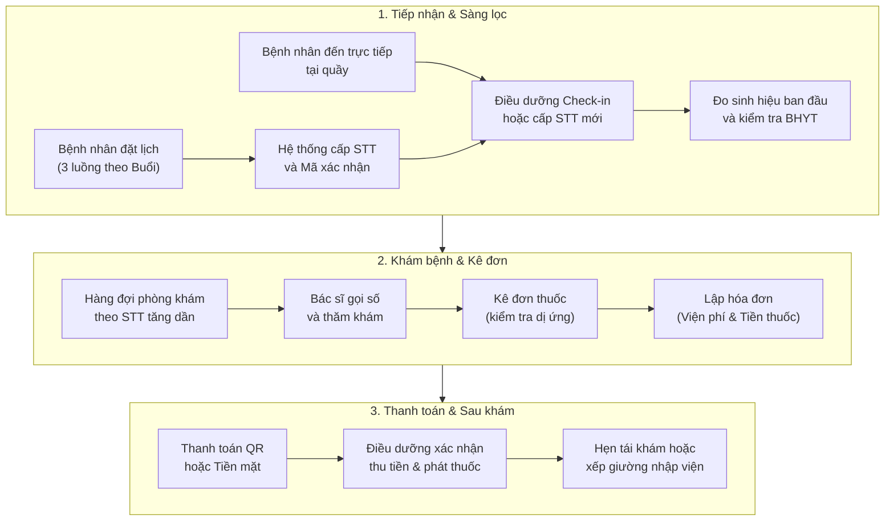

## 1.3. Cơ chế đặt lịch 3 luồng theo Buổi (Sáng/Chiều) & Cấp Số thứ tự

### 1.3.1. Nguyên tắc đặt lịch theo Buổi và đánh Số thứ tự (STT)

- **Chia ca theo 2 buổi trong ngày:**
  - **Buổi Sáng:** từ `07:30` đến `11:30`.
  - **Buổi Chiều:** từ `13:30` đến `17:00`.
- **Cấp Số thứ tự tự động và không trùng lặp:** Mỗi bác sĩ trong một ngày/buổi có một giới hạn lượt khám tối đa (mặc định 20 lượt/buổi). Khi người bệnh đặt lịch thành công (hoặc điều dưỡng tiếp nhận bệnh nhân đến trực tiếp), hệ thống tự động cấp một Số thứ tự tăng dần (`#01, #02, #03...`) gắn liền với bác sĩ, ngày và buổi đó.
- **Tính giờ khám dự kiến tham khảo:** Dựa trên giờ bắt đầu của buổi khám, số thứ tự được cấp và thời lượng khám trung bình mỗi lượt (ví dụ 12 phút/lượt), hệ thống tự động ước lượng thời gian dự kiến (ví dụ STT `#04` buổi sáng tương ứng khoảng `08:06`) để bệnh nhân chủ động sắp xếp thời gian đến viện.
- **Giữ nguyên STT khi có người hủy lịch:** Nếu một bệnh nhân hủy lịch (ví dụ người mang STT `#02` hủy), hệ thống **không đánh lại số của những người đã đặt** (`#03` vẫn giữ nguyên `#03`) để tránh gây xáo trộn phiếu hẹn của người khác; người đặt sau vẫn nhận số tiếp theo (`#04`).

### 1.3.2. Ba luồng đặt lịch linh hoạt cho người dùng cuối

Tùy theo thói quen tìm kiếm, người bệnh có thể bắt đầu đặt lịch từ 1 trong 3 cách:

1. **Theo Chuyên khoa:** Chọn chuyên khoa cần khám (bao gồm Nội tổng quát, Tim mạch, Nhi khoa, Da liễu, Ngoại khoa, Sản & Nhi...) $\rightarrow$ Chọn ngày khám $\rightarrow$ Chọn bác sĩ và buổi (Sáng/Chiều) còn chỗ.
2. **Theo Bác sĩ:** Tìm và chọn đích danh bác sĩ mong muốn $\rightarrow$ Chọn ngày và buổi (Sáng/Chiều) bác sĩ có lịch trực.
3. **Theo Ngày khám:** Chọn ngày rảnh trong tuần $\rightarrow$ Hệ thống liệt kê các chuyên khoa có bác sĩ trực trong ngày đó $\rightarrow$ Chọn chuyên khoa, bác sĩ và buổi khám.

## 1.4. Phân tích lựa chọn công nghệ và Cơ sở dữ liệu

### 1.4.1. Công nghệ xây dựng giao diện và máy chủ
- **Giao diện (Frontend):** Sử dụng **React + Vite + TypeScript + Tailwind CSS** giúp thao tác mượt mà trên cả máy tính lẫn điện thoại, chuyển đổi nhanh giữa các màn hình mà không phải tải lại trang, kèm thư viện biểu đồ trực quan cho trang thống kê bệnh viện.
- **Máy chủ xử lý (Backend):** Sử dụng **Node.js + Express + TypeScript + Prisma** tách biệt rõ tầng xử lý nghiệp vụ và phân quyền truy cập, đảm bảo mọi tính toán quan trọng (cấp STT, kiểm tra dị ứng, xác nhận thanh toán) đều được kiểm soát chặt chẽ tại máy chủ.

### 1.4.2. So sánh lựa chọn cơ sở dữ liệu: PostgreSQL + JSONB hay MongoDB?

Dữ liệu bệnh viện gồm hai nhóm tính chất trái ngược nhau:
- **Nhóm cần tính kỷ luật, ràng buộc chặt chẽ:** Tài khoản, phân ca bác sĩ, cấp số thứ tự không được trùng khi nhiều người bấm cùng lúc, hóa đơn viện phí/đơn thuốc, giao dịch thu tiền, trạng thái giường bệnh.
- **Nhóm có cấu trúc thay đổi linh hoạt theo từng chuyên khoa:** Chỉ số sinh hiệu khi sàng lọc, danh sách kiểm tra giấy tờ BHYT, tiền sử dị ứng và bệnh nền của từng bệnh nhân, kết quả khám chi tiết khác nhau giữa các khoa (Tim mạch khác Da liễu hay Nhi khoa), chi tiết các dòng thuốc/dịch vụ trong đơn và hóa đơn.

| Tiêu chí đánh giá | Chỉ dùng MongoDB | Tách 2 CSDL (PostgreSQL + MongoDB) | Dùng PostgreSQL + cột JSONB *(Lựa chọn)* |
| :--- | :--- | :--- | :--- |
| **Chống trùng STT & Khóa đồng thời** | Kiểm soát ràng buộc chéo nhiều thực thể phức tạp hơn. | Tốt ở phần PostgreSQL, nhưng dễ phát sinh lỗi đồng bộ khi dữ liệu nằm ở 2 nơi. | **Tốt nhất.** Hỗ trợ giao dịch an toàn, khóa dữ liệu tuần tự khi cấp STT và chặn trùng lịch ở mức cơ sở dữ liệu. |
| **Thanh toán viện phí & Đơn thuốc** | Dễ bị lệch trạng thái nếu thiếu cơ chế giao dịch chặt giữa hóa đơn và đơn thuốc. | Khó giữ giao dịch đồng bộ xuyên suốt 2 hệ CSDL khác nhau. | **An toàn tuyệt đối.** Cập nhật giao dịch thu tiền, hóa đơn, đơn thuốc và thông báo trong cùng một bước thống nhất. |
| **Lưu thông tin linh hoạt (sinh hiệu, kết quả khoa)** | Lưu tự nhiên dưới dạng tài liệu JSON. | Lưu sang MongoDB. | **Rất thuận tiện.** Cột `JSONB` cho phép lưu dữ liệu đa dạng cấu trúc ngay trong PostgreSQL và vẫn tìm kiếm nhanh. |
| **Thống kê Dashboard bệnh viện** | Tổng hợp số liệu từ nhiều bảng liên kết khá cồng kềnh. | Phải gom dữ liệu từ 2 nguồn khác nhau. | **Nhanh và chuẩn xác** khi tính toán lượt khám 7 ngày, công suất giường theo khoa và doanh thu. |
| **Cài đặt & Bảo trì** | Gọn nhẹ (1 hệ thống). | Tốn công cài đặt, sao lưu và đồng bộ gấp đôi. | **Gọn nhẹ tối ưu** (chỉ 1 hệ quản trị CSDL duy nhất cho toàn bộ ứng dụng). |

**Kết luận:** Chọn **PostgreSQL 16 kết hợp kiểu dữ liệu JSONB** là phương án hợp lý nhất: vừa bảo đảm an toàn tuyệt đối cho nghiệp vụ đặt lịch theo STT và thanh toán viện phí, vừa có được sự linh hoạt như NoSQL cho hồ sơ khám đa chuyên khoa mà không làm phức tạp hệ thống.

### 1.4.3. Hỗ trợ làm việc nhóm với Docker Compose và Tailscale
- **Docker Compose:** Đóng gói toàn bộ cơ sở dữ liệu PostgreSQL, máy chủ Backend và giao diện Frontend thành các khối đồng nhất. Thành viên mới chỉ cần tải mã nguồn về và chạy một lệnh khởi động là có đầy đủ môi trường và dữ liệu mẫu giống hệt nhau.
- **Tailscale:** Tạo mạng kết nối riêng tư giữa các máy tính và điện thoại trong nhóm qua Internet mà không cần thuê máy chủ đám mây hay mở cổng mạng phức tạp, rất tiện để cả nhóm cùng kiểm thử giao diện trên điện thoại thật.

---

# Chương 2: Phân tích yêu cầu & Đặc tả Use Case

## 2.1. Yêu cầu chức năng đầy đủ

### Nhóm 1: Chức năng chung & Tra cứu công khai
- **Đăng nhập, Đăng ký & Tài khoản cá nhân:** Người bệnh tự đăng ký tài khoản mới; hỗ trợ đăng nhập bằng email và mật khẩu; cung cấp sẵn nút chọn nhanh các tài khoản mẫu cho 4 vai trò để thuận tiện kiểm thử; cho phép cập nhật thông tin cá nhân và đổi mật khẩu.
- **Tra cứu bác sĩ & Hỗ trợ:** Cho phép xem danh sách bác sĩ theo chuyên khoa, phòng khám, kinh nghiệm và xem lịch trống theo 3 luồng; cung cấp mục Trung tâm trợ giúp hướng dẫn quy trình đặt lịch và thanh toán.
- **Hệ thống thông báo:** Tự động gửi thông báo khi đặt lịch thành công, khi bác sĩ gọi số tới lượt, khi có kết quả khám/đơn thuốc mới, khi bác sĩ đặt lịch tái khám và khi điều dưỡng xác nhận đã thanh toán.

### Nhóm 2: Cổng Bệnh nhân
- **Trang chủ cá nhân hóa:** Hiển thị lời chào, thẻ nhắc lịch hẹn sắp tới (kèm STT và giờ dự kiến), 6 ô dịch vụ truy cập nhanh, lịch hẹn gần nhất và thông báo mới.
- **Đặt lịch khám 3 luồng:** Đặt lịch theo Chuyên khoa (gồm Nội tổng quát), theo Bác sĩ hoặc theo Ngày; chọn buổi Sáng/Chiều và nhận ngay phiếu hẹn có STT cùng mã check-in.
- **Quản lý lịch hẹn:** Xem chi tiết lịch hẹn, theo dõi STT đang khám hiện tại tại phòng khám để ước lượng thời gian chờ, đổi lịch sang ngày/buổi khác hoặc hủy lịch kèm lý do.
- **Hồ sơ sức khỏe:** Xem và cập nhật thông tin hành chính, số thẻ BHYT, nhóm máu, tiền sử dị ứng thuốc/thực phẩm, bệnh nền và người liên hệ khẩn cấp; tra cứu lại toàn bộ lịch sử khám và lịch sử đơn thuốc.
- **Xem kết quả khám & đơn thuốc:** Xem đầy đủ chỉ số sinh hiệu, triệu chứng, chẩn đoán, kết quả cận lâm sàng và danh sách thuốc (liều lượng, cách dùng), hỗ trợ bản xem thân thiện để in.
- **Thanh toán viện phí & đơn thuốc:** Phân tách rõ hóa đơn phí khám/xét nghiệm và hóa đơn tiền thuốc; hỗ trợ quét mã QR chuyển khoản mô phỏng hoặc đăng ký đóng tiền mặt tại quầy; xem biên lai đã thanh toán.

### Nhóm 3: Cổng Bác sĩ
- **Danh sách hàng đợi theo buổi & STT:** Xem danh sách bệnh nhân phân chia theo Buổi Sáng / Buổi Chiều, sắp xếp theo STT tăng dần; thao tác nút **"Gọi số tiếp theo"** để mời bệnh nhân vào khám.
- **Xem hồ sơ & Tiền sử người bệnh:** Xem thông tin cá nhân, **cảnh báo nổi bật tiền sử dị ứng**, chỉ số sinh hiệu do điều dưỡng đo trước đó và lịch sử các lần khám cũ.
- **Khám bệnh, Kết luận & Kê đơn thuốc:** Nhập triệu chứng, chẩn đoán (kèm mã bệnh ICD-10), kết quả chuyên khoa, chỉ định xét nghiệm cận lâm sàng; chọn thuốc từ danh mục kèm liều dùng; hệ thống **tự động cảnh báo nếu thuốc kê trùng với dị ứng hoặc bệnh nền của bệnh nhân**; công bố kết quả khám để tự động tạo hóa đơn và gửi thông báo cho bệnh nhân.
- **Đặt lịch tái khám cho bệnh nhân:** Đặt lịch tái khám hoặc chuyển chuyên khoa theo ngày và buổi ngay tại màn hình khám bệnh, cấp luôn STT mới cho bệnh nhân.
- **Quản lý lịch trực cá nhân:** Bật/tắt trạng thái nhận đặt lịch cho từng buổi khám và điều chỉnh số lượt khám tối đa mỗi buổi.

### Nhóm 4: Cổng Điều dưỡng
- **Tiếp đón & Check-in:** Xác nhận bệnh nhân đặt lịch trực tuyến đã đến viện theo mã hẹn hoặc STT; tiếp nhận đăng ký khám trực tiếp tại quầy cho bệnh nhân vãng lai (có tùy chọn ưu tiên và cấp STT kế tiếp).
- **Làm thủ tục & Đo sinh hiệu ban đầu:** Đo và ghi nhận huyết áp, mạch, nhiệt độ, SpO2, chiều cao, cân nặng (tự tính chỉ số BMI) cùng danh sách kiểm tra giấy tờ, thẻ BHYT trước khi bệnh nhân vào gặp bác sĩ.
- **Xác nhận thanh toán & Cấp phát thuốc:** Kiểm tra các hóa đơn viện phí/đơn thuốc đang chờ thanh toán hoặc chờ đối soát chuyển khoản QR; xác nhận đã thu tiền (hoặc từ chối giao dịch QR chưa hợp lệ); thực hiện xác nhận cấp phát thuốc và tự động trừ tồn kho cho các đơn thuốc đã thanh toán.
- **Quản lý giường bệnh nội trú:** Theo dõi sơ đồ giường theo từng khoa và phòng (Trống, Đang sử dụng, Bảo trì); thực hiện xếp giường nhập viện, chuyển giường, xuất viện hoặc chuyển trạng thái bảo trì.

### Nhóm 5: Cổng Trưởng bệnh viện / Quản lý
- **Bảng điều khiển thống kê tổng quan:** Hiển thị 4 chỉ số chính (Lượt khám hôm nay, Lịch hẹn hôm nay, Bác sĩ đang trực, Giường đang sử dụng), biểu đồ so sánh lượt khám 7 ngày qua với 7 ngày trước, danh sách bác sĩ đang trực, bảng lịch hẹn hôm nay có bộ lọc tìm kiếm, biểu đồ tỷ lệ sử dụng giường bệnh theo từng khoa và thống kê doanh thu (viện phí và tiền thuốc).
- **Quản trị danh mục & vận hành:** Quản lý Khoa chuyên môn, Phòng khám, Giường bệnh; quản lý danh sách Bác sĩ, Điều dưỡng và phân công lịch trực; quản lý danh mục Thuốc (đơn giá, tồn kho, chống chỉ định) và Dịch vụ kỹ thuật; tra cứu toàn bộ lịch hẹn, bệnh nhân, hồ sơ bệnh án và xuất file báo cáo Excel/CSV.

## 2.2. Yêu cầu phi chức năng

1. **Bảo mật & Phân quyền chặt chẽ:** Mật khẩu người dùng được mã hóa một chiều; mỗi chức năng chỉ cho phép đúng vai trò truy cập (bệnh nhân chỉ xem được hồ sơ, đơn thuốc và hóa đơn của chính mình; nhân viên y tế chỉ thao tác đúng nghiệp vụ được giao).
2. **An toàn và toàn vẹn dữ liệu:** Đảm bảo không bao giờ cấp trùng STT khi nhiều người đặt lịch cùng lúc; đảm bảo thao tác xác nhận thanh toán diễn ra trọn vẹn (hóa đơn, đơn thuốc và thông báo đồng bộ cùng lúc, nếu có sự cố thì hủy toàn bộ bước dở dang).
3. **Giao diện thân thiện trên nhiều thiết bị:** Tự động điều chỉnh bố cục gọn gàng trên màn hình điện thoại (có thanh điều hướng phía dưới) và đầy đủ thông tin trên màn hình máy tính (có thanh menu bên trái).
4. **Hiệu năng ổn định:** Thời gian phản hồi các thao tác tra cứu lịch trống, lưu bệnh án và tổng hợp biểu đồ thống kê nhanh chóng, mượt mà.

## 2.3. Sơ đồ Use Case tổng quát & từng vai trò

### 2.3.1. Sơ đồ Use Case tổng quát toàn hệ thống

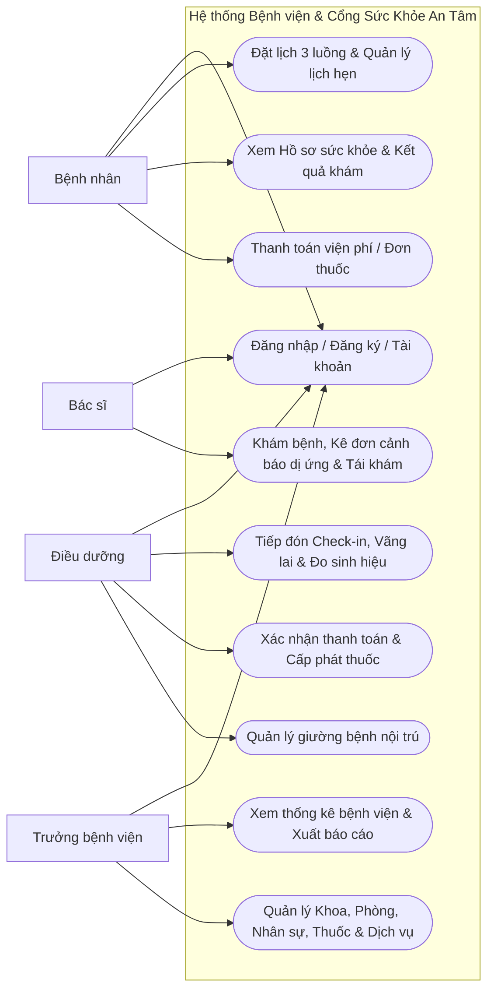

### 2.3.2. Sơ đồ Use Case chi tiết theo 4 vai trò

#### a) Vai trò Bệnh nhân

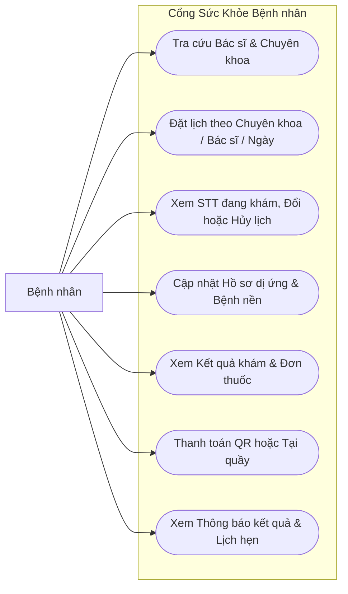

#### b) Vai trò Bác sĩ

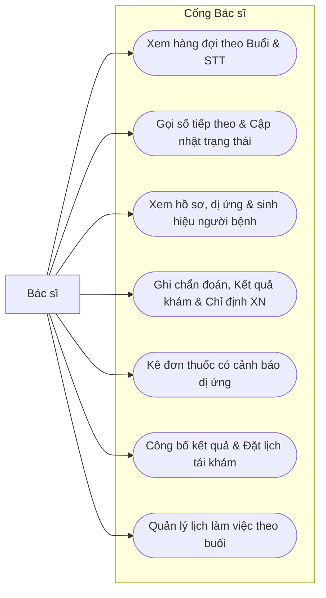

#### c) Vai trò Điều dưỡng

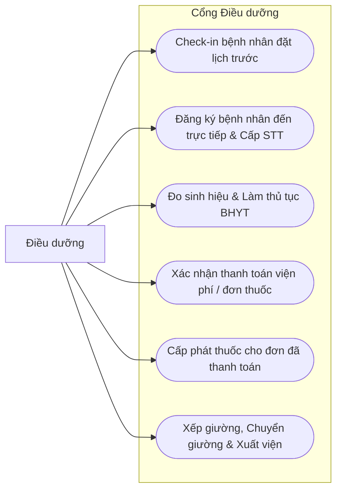

#### d) Vai trò Trưởng bệnh viện

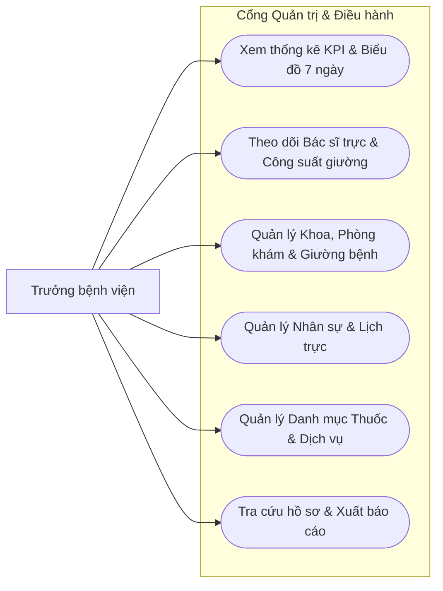

## 2.4. Bảng đặc tả chi tiết các Use Case cốt lõi

### UC-01: Đặt lịch khám 3 luồng theo Buổi & Cấp Số thứ tự

| Thành phần | Mô tả nghiệp vụ |
| :--- | :--- |
| **Tên Use Case** | Đặt lịch khám 3 luồng theo Buổi (Sáng/Chiều) và cấp Số thứ tự tự động |
| **Tác nhân** | Bệnh nhân |
| **Mô tả tóm tắt** | Người bệnh chọn đặt lịch theo Chuyên khoa, theo Bác sĩ hoặc theo Ngày; chọn buổi còn lượt trống và nhận phiếu hẹn kèm STT. |
| **Điều kiện tiên quyết** | Bệnh nhân đã đăng nhập hệ thống; lịch làm việc của bác sĩ vào ngày và buổi đó đang mở nhận bệnh. |
| **Kết quả sau thực hiện** | Hệ thống tạo lịch hẹn mới với STT duy nhất trong buổi, tính giờ khám dự kiến và gửi thông báo xác nhận cho bệnh nhân. |
| **Luồng sự kiện chính** | 1. Bệnh nhân vào trang **Đặt lịch khám** và chọn cách tìm kiếm mong muốn (Theo chuyên khoa / Theo bác sĩ / Theo ngày). 2. Hệ thống hiển thị danh sách bác sĩ cùng số lượt còn trống và STT dự kiến của Buổi Sáng / Buổi Chiều. 3. Bệnh nhân chọn buổi khám phù hợp, nhập triệu chứng ban đầu và bấm **Xác nhận đặt lịch**. 4. Hệ thống khóa tạm lịch buổi đó để kiểm tra điều kiện (còn chỗ, chưa đặt trùng bác sĩ trong cùng buổi), cấp STT kế tiếp và lưu lịch hẹn. 5. Màn hình hiển thị phiếu xác nhận có mã lịch hẹn, STT và giờ dự kiến. |
| **Trường hợp ngoại lệ** | - **Buổi khám đã đủ lượt:** Hệ thống báo buổi đã đầy và gợi ý chọn buổi/ngày khác. - **Đặt trùng buổi:** Bệnh nhân đã có lịch hẹn chưa hủy với cùng bác sĩ trong cùng buổi đó $\rightarrow$ hệ thống thông báo không cho đặt trùng. - **Hủy lịch sau khi đặt:** Lịch hẹn chuyển sang trạng thái đã hủy, STT của những bệnh nhân khác vẫn giữ nguyên. |

### UC-02: Tiếp đón Check-in, Đăng ký khám trực tiếp & Đo sinh hiệu

| Thành phần | Mô tả nghiệp vụ |
| :--- | :--- |
| **Tên Use Case** | Tiếp đón Check-in, Đăng ký bệnh nhân đến trực tiếp và Đo sinh hiệu sàng lọc |
| **Tác nhân** | Điều dưỡng |
| **Mô tả tóm tắt** | Điều dưỡng xác nhận bệnh nhân đặt trước đã có mặt hoặc tạo phiếu khám tại quầy cho bệnh nhân vãng lai, sau đó đo chỉ số sinh hiệu và kiểm tra thủ tục giấy tờ trước khi vào phòng bác sĩ. |
| **Điều kiện tiên quyết** | Điều dưỡng đã đăng nhập; phòng khám của bác sĩ đang có lịch làm việc trong buổi hiện tại. |
| **Kết quả sau thực hiện** | Bệnh nhân chuyển sang trạng thái sẵn sàng khám; thông tin sinh hiệu và thủ tục BHYT được gắn trực tiếp vào phiếu khám. |
| **Luồng sự kiện chính** | 1. Điều dưỡng tìm lịch hẹn của bệnh nhân theo mã hẹn, số điện thoại hoặc STT. 2. Với bệnh nhân đã đặt online: bấm **Check-in** để xác nhận có mặt. 3. Với bệnh nhân vãng lai: chọn hồ sơ (hoặc tạo nhanh thông tin bệnh nhân), chọn bác sĩ/buổi hiện tại, đánh dấu ưu tiên nếu cần để hệ thống cấp STT kế tiếp. 4. Điều dưỡng đo và nhập huyết áp, nhịp tim, nhiệt độ, SpO2, chiều cao, cân nặng (tự tính BMI) cùng checklist kiểm tra BHYT. 5. Hệ thống lưu thông tin và đưa bệnh nhân lên danh sách chờ của bác sĩ. |
| **Trường hợp ngoại lệ** | - **Sai mã hẹn hoặc lịch đã hủy:** Hệ thống thông báo không thể check-in. - **Thiếu hoặc sai định dạng chỉ số đo:** Giao diện nhắc điều dưỡng kiểm tra lại trước khi lưu. |

### UC-03: Khám bệnh, Kê đơn cảnh báo dị ứng & Đặt lịch tái khám

| Thành phần | Mô tả nghiệp vụ |
| :--- | :--- |
| **Tên Use Case** | Thăm khám lâm sàng, Kê đơn thuốc cảnh báo dị ứng và Đặt lịch tái khám |
| **Tác nhân** | Bác sĩ |
| **Mô tả tóm tắt** | Bác sĩ gọi bệnh nhân theo STT, xem sinh hiệu và tiền sử dị ứng, lập bệnh án, kê đơn thuốc có cảnh báo xung đột dị ứng tự động, phát hành hóa đơn và hẹn tái khám. |
| **Điều kiện tiên quyết** | Bác sĩ đã đăng nhập; có bệnh nhân đang chờ khám trong danh sách buổi hiện tại. |
| **Kết quả sau thực hiện** | Hồ sơ bệnh án, đơn thuốc, hóa đơn viện phí/tiền thuốc được lưu đồng bộ; bệnh nhân nhận được thông báo kết quả khám. |
| **Luồng sự kiện chính** | 1. Bác sĩ bấm **Gọi số tiếp theo** để mời bệnh nhân vào khám. 2. Màn hình hiển thị thông tin bệnh nhân, cảnh báo dị ứng nổi bật, chỉ số sinh hiệu từ điều dưỡng và lịch sử các lần khám trước. 3. Bác sĩ ghi nhận triệu chứng, chẩn đoán, mã bệnh, kết quả chuyên khoa và chỉ định dịch vụ cận lâm sàng. 4. Khi bác sĩ thêm thuốc vào đơn, hệ thống tự động đối chiếu với danh sách dị ứng và bệnh nền của bệnh nhân; nếu có nguy cơ sẽ hiện cảnh báo đỏ ngay lập tức. 5. Bác sĩ bấm **Công bố kết quả & Đơn thuốc**: hệ thống lưu bệnh án, tạo hóa đơn tương ứng, gửi thông báo cho bệnh nhân và hoàn tất lượt khám. 6. Nếu cần, bác sĩ chọn ngày và buổi tái khám để cấp luôn STT mới cho lần hẹn sau. |
| **Trường hợp ngoại lệ** | - **Thuốc có nguy cơ gây dị ứng:** Hệ thống cảnh báo rõ tên dị nguyên trùng khớp để bác sĩ đổi thuốc an toàn hơn. - **Ngày tái khám bác sĩ không trực hoặc đã đầy:** Hệ thống thông báo để chọn ngày/buổi khác. |

### UC-04: Thanh toán viện phí / đơn thuốc & Cấp phát thuốc

| Thành phần | Mô tả nghiệp vụ |
| :--- | :--- |
| **Tên Use Case** | Thanh toán hóa đơn viện phí / đơn thuốc và Xác nhận thu ngân – cấp phát thuốc |
| **Tác nhân** | Bệnh nhân, Điều dưỡng |
| **Mô tả tóm tắt** | Bệnh nhân thực hiện thanh toán qua chuyển khoản QR mô phỏng hoặc đăng ký đóng tiền mặt; điều dưỡng kiểm tra đối soát xác nhận thu tiền và thực hiện cấp phát thuốc. |
| **Điều kiện tiên quyết** | Hóa đơn viện phí hoặc đơn thuốc đã được tạo ở trạng thái chưa thanh toán. |
| **Kết quả sau thực hiện** | Hóa đơn chuyển sang đã thanh toán, mở khóa trạng thái đơn thuốc để cấp phát, trừ tồn kho thuốc và gửi thông báo biên lai cho bệnh nhân. |
| **Luồng sự kiện chính** | 1. Bệnh nhân vào mục **Thanh toán** để xem chi tiết từng hóa đơn (phí khám/dịch vụ tách riêng với tiền thuốc). 2. Bệnh nhân chọn quét mã QR chuyển khoản (chuyển sang chờ đối soát) hoặc chọn đóng tiền mặt tại quầy. 3. Điều dưỡng/thu ngân kiểm tra giao dịch trên màn hình Thu ngân và bấm **Xác nhận thanh toán**. 4. Hệ thống cập nhật đồng bộ trạng thái thanh toán của hóa đơn, đơn thuốc và gửi thông báo xác nhận cho bệnh nhân. 5. Điều dưỡng giao thuốc cho người bệnh và xác nhận đã cấp phát trên hệ thống (tự động trừ số lượng tồn kho). |
| **Trường hợp ngoại lệ** | - **Giao dịch chuyển khoản không hợp lệ:** Điều dưỡng có thể bấm từ chối để đưa hóa đơn về trạng thái chưa thanh toán. - **Đơn thuốc chưa thanh toán hoặc thuốc hết tồn kho:** Hệ thống ngăn không cho cấp phát và thông báo rõ lý do. |

### UC-05: Quản lý giường bệnh nội trú & Xem thống kê bệnh viện

| Thành phần | Mô tả nghiệp vụ |
| :--- | :--- |
| **Tên Use Case** | Điều phối giường bệnh nội trú và Theo dõi thống kê điều hành bệnh viện |
| **Tác nhân** | Điều dưỡng, Trưởng bệnh viện |
| **Mô tả tóm tắt** | Điều dưỡng cập nhật tình trạng xếp giường, chuyển giường, xuất viện theo khoa; mọi thay đổi tự động cập nhật lên biểu đồ công suất giường và các thống kê của Trưởng bệnh viện. |
| **Điều kiện tiên quyết** | Danh mục khoa, phòng và giường bệnh đã được khởi tạo; người dùng có quyền Điều dưỡng hoặc Trưởng bệnh viện. |
| **Kết quả sau thực hiện** | Tình trạng giường và lịch sử sử dụng giường được lưu chính xác; bảng điều khiển của Trưởng bệnh viện hiển thị số liệu thời gian thực. |
| **Luồng sự kiện chính** | 1. Điều dưỡng mở màn hình **Quản lý Giường bệnh**, chọn giường trống để nhập viện cho bệnh nhân, chuyển sang giường khác hoặc làm thủ tục xuất viện trả giường trống. 2. Trưởng bệnh viện mở trang **Tổng quan bệnh viện**: hệ thống tổng hợp lượt khám trong ngày, biểu đồ so sánh 7 ngày qua với 7 ngày trước, danh sách bác sĩ đang trực, bảng lịch hẹn hôm nay, tỷ lệ giường đang sử dụng theo khoa và doanh thu. 3. Trưởng bệnh viện có thể lọc lịch hẹn hoặc xuất báo cáo CSV phục vụ họp giao ban. |
| **Trường hợp ngoại lệ** | - **Xếp bệnh nhân vào giường đang có người hoặc đang bảo trì:** Hệ thống từ chối và yêu cầu chọn giường trống khác. |

## 2.5. Sơ đồ hoạt động và Sơ đồ tuần tự

### 2.5.1. Sơ đồ hoạt động — Quy trình khám chữa bệnh khép kín tại An Tâm

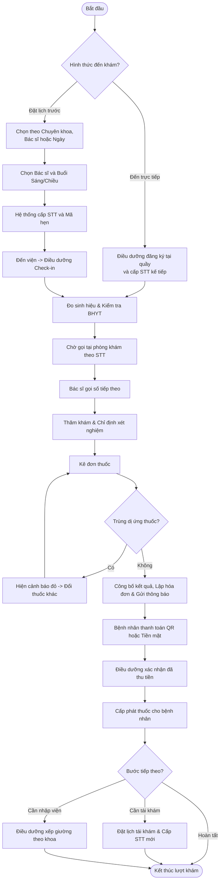

### 2.5.2. Sơ đồ tuần tự — Đặt lịch khám theo buổi & Cấp STT

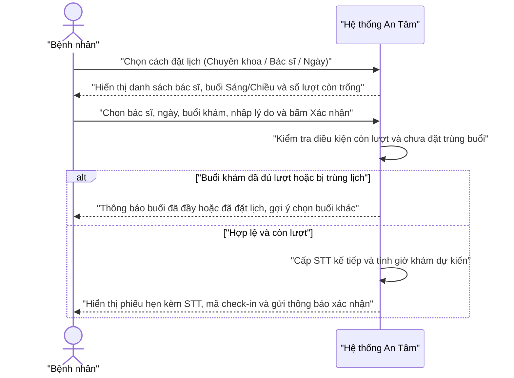

### 2.5.3. Sơ đồ tuần tự — Khám bệnh, Cảnh báo dị ứng & Công bố kết quả

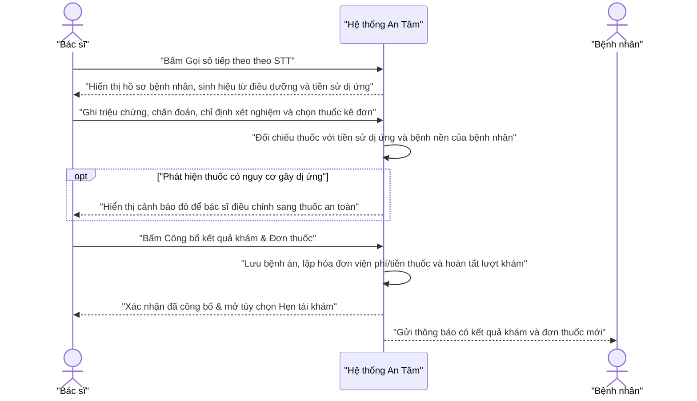

### 2.5.4. Sơ đồ tuần tự — Thanh toán & Xác nhận cấp phát thuốc

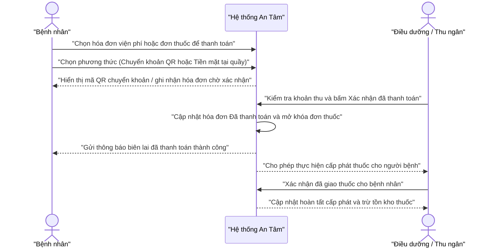

---

# Chương 3: Thiết kế Kiến trúc & Cơ sở dữ liệu

## 3.1. Kiến trúc tổng thể hệ thống

Hệ thống được tổ chức theo mô hình **3 tầng rõ ràng**:

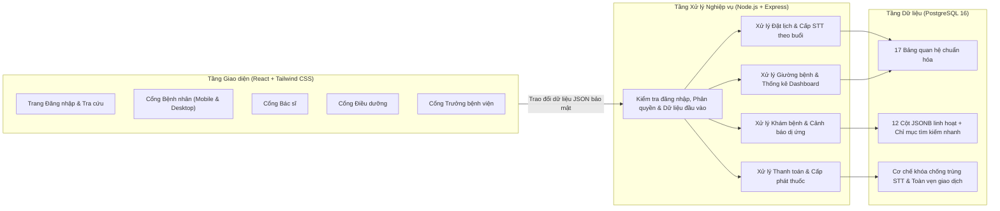

1. **Tầng Giao diện:** Hiển thị trực quan cho từng vai trò, hỗ trợ cả máy tính và điện thoại. Mọi phép tính quan trọng (cấp số thứ tự, kiểm tra dị ứng thuốc, tổng tiền hóa đơn, đối soát thu tiền) đều được xử lý ở máy chủ để bảo đảm an toàn.
2. **Tầng Xử lý Nghiệp vụ:** Kiểm tra danh tính và vai trò trước mọi thao tác; các bước lưu nhiều bảng cùng lúc (như công bố bệnh án + sinh hóa đơn, xác nhận thanh toán + mở khóa đơn thuốc) được thực hiện trọn gói trong một giao dịch.
3. **Tầng Dữ liệu:** Sử dụng **PostgreSQL 16** với **17 bảng nghiệp vụ** kết hợp **12 cột JSONB** giúp cấu trúc gọn nhẹ mà vẫn bảo đảm tính chặt chẽ và toàn vẹn dữ liệu.

## 3.2. Sơ đồ Thực thể – Liên kết (ERD) theo phân hệ

Để dễ quan sát, đối chiếu và trình bày báo cáo, sơ đồ ERD của 17 bảng dữ liệu được chia nhỏ thành **4 sơ đồ theo từng phân hệ nghiệp vụ**:

### 3.2.1. Phân hệ Tài khoản, Hồ sơ & Thông báo

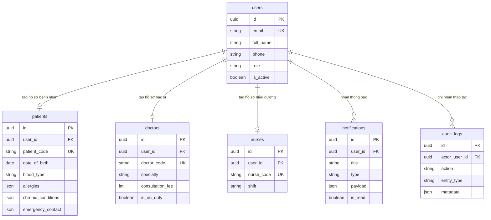

### 3.2.2. Phân hệ Tổ chức Khoa, Phòng khám & Giường bệnh

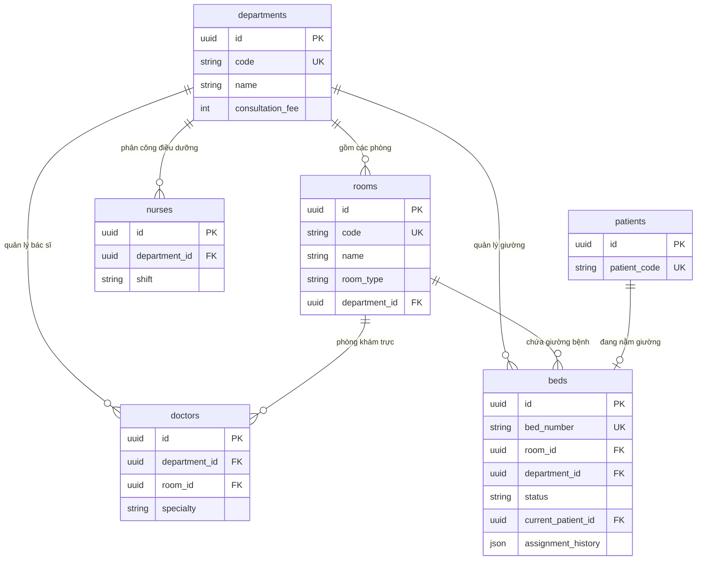

### 3.2.3. Phân hệ Lịch trực, Đặt lịch (STT) & Khám chữa bệnh

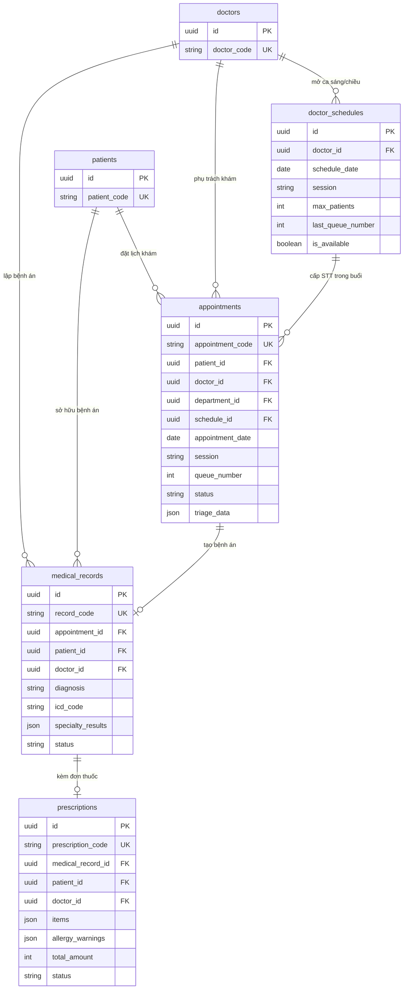

### 3.2.4. Phân hệ Thanh toán, Cấp phát thuốc & Danh mục Dịch vụ

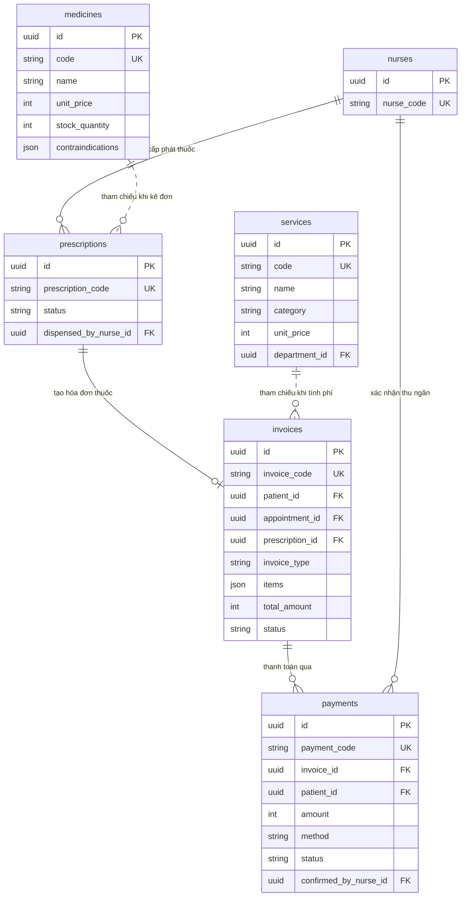

## 3.3. Mô tả chi tiết 17 bảng dữ liệu

Hệ thống tổ chức cơ sở dữ liệu gồm **17 bảng nghiệp vụ** trên PostgreSQL 16, chia thành 5 phân hệ dữ liệu:

### Nhóm 1: Tài khoản, Tổ chức & Cơ sở vật chất (4 bảng)
| Tên bảng | Ý nghĩa | Thông tin chính lưu trữ |
| :--- | :--- | :--- |
| `users` | Tài khoản đăng nhập | Email, mật khẩu đã mã hóa, họ tên, số điện thoại, vai trò (`Bệnh nhân`, `Bác sĩ`, `Điều dưỡng`, `Quản lý`), trạng thái hoạt động. |
| `departments` | Chuyên khoa | Mã khoa, tên khoa (Nội tổng quát, Tim mạch, Nhi khoa, Da liễu, Ngoại khoa...), vị trí, mức phí khám mặc định. |
| `rooms` | Phòng khám & Phòng bệnh | Mã phòng, tên phòng (Phòng 201, Phòng 305, Phòng 102...), loại phòng (phòng khám, phòng nội trú, phòng xét nghiệm...), thuộc khoa nào. |
| `beds` | Giường bệnh nội trú | Số giường, thuộc phòng/khoa nào, trạng thái (`Trống`, `Đang sử dụng`, `Bảo trì`), bệnh nhân đang nằm (mỗi bệnh nhân chỉ nằm tối đa 1 giường), và **lịch sử nhập/chuyển/xuất giường dạng JSON**. |

### Nhóm 2: Hồ sơ người bệnh & Nhân sự (3 bảng)
| Tên bảng | Ý nghĩa | Thông tin chính lưu trữ |
| :--- | :--- | :--- |
| `patients` | Hồ sơ bệnh nhân | Mã bệnh nhân (`BN-08250`), ngày sinh, giới tính, địa chỉ, CCCD, số BHYT, nhóm máu, **danh sách dị ứng (JSON)**, **bệnh nền (JSON)**, **người liên hệ khẩn cấp (JSON)**. |
| `doctors` | Hồ sơ bác sĩ | Mã bác sĩ, chuyên khoa, phòng trực chính, học vị, số năm kinh nghiệm, phí khám, trạng thái đang trực. |
| `nurses` | Hồ sơ điều dưỡng | Mã điều dưỡng, khoa công tác, ca trực. |

### Nhóm 3: Lịch trực & Đặt lịch khám (2 bảng)
| Tên bảng | Ý nghĩa | Thông tin chính lưu trữ |
| :--- | :--- | :--- |
| `doctor_schedules` | Lịch trực theo buổi | Bác sĩ, ngày trực, buổi (`Sáng`/`Chiều`), giờ bắt đầu–kết thúc, số lượt tối đa/buổi, thời lượng khám TB, bộ đếm STT cao nhất đã cấp, trạng thái mở/khóa buổi. |
| `appointments` | Lịch hẹn & Hàng đợi | Mã lịch hẹn, bệnh nhân, bác sĩ, khoa, ngày khám, buổi (`Sáng`/`Chiều`), **Số thứ tự (`STT`)**, giờ dự kiến, hình thức đặt (`Online`/`Vãng lai`/`Tái khám`), luồng đặt, trạng thái, lý do khám, và **dữ liệu sàng lọc Triage của điều dưỡng dạng JSON**. |

### Nhóm 4: Khám bệnh, Danh mục Thuốc & Dịch vụ (4 bảng)
| Tên bảng | Ý nghĩa | Thông tin chính lưu trữ |
| :--- | :--- | :--- |
| `medical_records` | Hồ sơ kết quả khám | Mã hồ sơ, gắn với 1 lịch hẹn, triệu chứng, chẩn đoán, mã bệnh ICD-10, ghi chú lâm sàng, hướng điều trị, **kết quả chuyên khoa & xét nghiệm cận lâm sàng (JSON)**, trạng thái nháp/đã công bố. |
| `medicines` | Danh mục thuốc | Mã thuốc, tên thuốc, hoạt chất, đơn vị tính, đơn giá, số lượng tồn kho, dạng bào chế, **thông tin chống chỉ định & dị nguyên (JSON)**. |
| `services` | Danh mục dịch vụ y tế | Mã dịch vụ, tên dịch vụ (Khám chuyên khoa, Xét nghiệm máu, Siêu âm, Điện tâm đồ...), đơn giá. |
| `prescriptions` | Đơn thuốc | Mã đơn, gắn với hồ sơ khám, lời dặn bác sĩ, **cảnh báo dị ứng phát hiện (JSON)**, **danh sách chi tiết các thuốc đã kê (JSON)**, tổng tiền, trạng thái thanh toán/cấp phát, điều dưỡng phát thuốc. |

### Nhóm 5: Thanh toán, Thông báo & Nhật ký (4 bảng)
| Tên bảng | Ý nghĩa | Thông tin chính lưu trữ |
| :--- | :--- | :--- |
| `invoices` | Hóa đơn | Mã hóa đơn, loại hóa đơn (`Viện phí` hoặc `Đơn thuốc`), **danh sách các khoản thu chi tiết (JSON)**, tạm tính, miễn giảm BHYT, tổng tiền cần trả, trạng thái thanh toán. |
| `payments` | Giao dịch thanh toán | Mã giao dịch, gắn với hóa đơn, số tiền, phương thức (`Chuyển khoản QR`, `Tiền mặt tại quầy`), trạng thái (`Chờ đối soát`, `Đã xác nhận`, `Từ chối`), điều dưỡng xác nhận. |
| `notifications` | Thông báo người dùng | Người nhận, tiêu đề, nội dung, phân loại (Lịch hẹn, Gọi số, Kết quả khám, Thanh toán), **dữ liệu đính kèm điều hướng nhanh (JSON)**, trạng thái đã đọc. |
| `audit_logs` | Nhật ký hệ thống | Người thao tác, hành động thực hiện, đối tượng tác động, **chi tiết thay đổi (JSON)**, thời điểm thực hiện. |

## 3.4. Thiết kế dữ liệu dạng JSON (JSONB)

Nhờ kiểu dữ liệu `JSONB` kèm chỉ mục tìm kiếm nhanh của PostgreSQL, hệ thống lưu **12 nhóm thông tin bán cấu trúc** dưới dạng JSON ngay trong các bảng chính:

| Bảng chứa & Cột JSON | Nội dung lưu bên trong | Lợi ích thiết kế |
| :--- | :--- | :--- |
| `patients` $\rightarrow$ Dị ứng, Bệnh nền, Liên hệ khẩn cấp | Danh sách dị nguyên + mức độ nặng nhẹ; danh sách bệnh mạn tính; tên/SĐT người thân. | Dễ mở rộng nhiều mục cho từng bệnh nhân mà vẫn gọn trong một bảng hồ sơ. |
| `appointments` $\rightarrow$ Dữ liệu sàng lọc Triage | Chỉ số sinh hiệu (huyết áp, nhịp tim, nhiệt độ, SpO2, chiều cao, cân nặng, BMI), checklist BHYT và tên điều dưỡng đo. | Lưu trọn bộ thông tin sàng lọc 1-1 ngay trên lịch hẹn, truy xuất nhanh khi bác sĩ mở danh sách khám. |
| `medical_records` $\rightarrow$ Kết quả chuyên khoa & Cận lâm sàng | Kết quả khám đặc thù từng khoa và danh sách kết quả xét nghiệm, siêu âm. | Đáp ứng linh hoạt mẫu kết quả khác nhau giữa các chuyên khoa. |
| `medicines` $\rightarrow$ Chống chỉ định | Danh sách dị nguyên và bệnh nền không được dùng thuốc. | Đối chiếu tự động với hồ sơ dị ứng của bệnh nhân ngay khi kê đơn. |
| `prescriptions` $\rightarrow$ Danh sách thuốc & Cảnh báo dị ứng | Chi tiết tên thuốc, đơn giá lúc kê, liều dùng, số ngày, số lượng và các cảnh báo dị ứng đã phát hiện. | Đọc trọn bộ đơn thuốc chỉ với một truy vấn và bảo toàn đúng tên/giá thuốc tại thời điểm kê đơn. |
| `invoices` $\rightarrow$ Chi tiết khoản thu | Từng dòng phí khám, phí xét nghiệm hoặc thuốc trong hóa đơn. | Quản lý chi tiết các mục thu gọn nhẹ trong khi vẫn giữ cột tổng tiền để thống kê doanh thu chính xác. |
| `beds` $\rightarrow$ Lịch sử điều phối giường | Nhật ký các lần nhập viện, chuyển giường, xuất viện gắn trên từng giường. | Tra cứu trực tiếp lịch sử sử dụng trên từng giường bệnh nội trú. |
| `notifications` & `audit_logs` $\rightarrow$ Dữ liệu đính kèm | Mã lịch hẹn, STT, mã hóa đơn hoặc thông tin thay đổi khi ghi log. | Hỗ trợ bấm vào thông báo là mở đúng trang chi tiết liên quan. |

## 3.5. Cơ chế chống trùng Số thứ tự (STT) khi đặt lịch đồng thời

Để xử lý tình huống hai bệnh nhân (hoặc điều dưỡng tại quầy) cùng đặt lịch cho một bác sĩ vào cùng một buổi tại cùng một thời điểm, hệ thống áp dụng **2 lớp bảo vệ**:
1. **Lớp khóa xử lý tuần tự:** Trước khi cấp STT, hệ thống khóa tạm đúng dòng lịch trực của bác sĩ trong buổi đó để các yêu cầu trùng thời điểm tự động xếp hàng xử lý lần lượt, đảm bảo không vượt quá số lượt tối đa (`maxPatients`) và bộ đếm STT tăng liên tiếp không trùng nhau.
2. **Lớp ràng buộc cứng ở cơ sở dữ liệu:** Cơ sở dữ liệu có sẵn quy tắc tự động từ chối nếu xuất hiện 2 lịch hẹn còn hiệu lực (chưa hủy) có cùng bác sĩ, ngày, buổi và trùng STT; đồng thời chặn một bệnh nhân tự đặt 2 lịch còn hiệu lực với cùng bác sĩ trong cùng một buổi. Khi người bệnh hủy lịch cũ, quy tắc này tự động cho phép họ đặt lại lịch mới trong buổi đó và nhận STT mới ở cuối hàng đợi.

---

# Chương 4: Thiết kế Giao diện & Trải nghiệm người dùng

## 4.1. Ngôn ngữ thiết kế (Design System "An Tâm")

Giao diện hệ thống được thiết kế thống nhất theo phong cách y tế hiện đại: sáng sủa, sạch sẽ, độ tương phản rõ nét để nhân viên y tế làm việc liên tục không mỏi mắt và người lớn tuổi dễ đọc trên điện thoại:

| Thành phần giao diện | Màu sắc sử dụng | Vai trò & Ý nghĩa |
| :--- | :--- | :--- |
| **Nền trang tổng thể** | Xanh băng nhạt (`#EEF4FB`) | Làm nổi bật rõ các khối thẻ nội dung màu trắng phía trên. |
| **Thẻ nội dung & Bảng** | Trắng tinh khiết (`#FFFFFF`), viền `#C7D6EA` | Bo góc mềm mại, phân tách rõ ràng từng khu vực thông tin. |
| **Màu xanh chủ đạo** | Xanh y tế đậm (`#1D5BB8`) | Dùng cho nút hành động chính, thanh điều hướng đang chọn và biểu đồ chính, bảo đảm độ tương phản chữ trắng rõ nét. |
| **Màu nhấn nhẹ & Khối phụ** | Xanh nhạt (`#DCEAFB` / `#EDF3FB`) | Làm nền cho ô menu đang chọn, thẻ thông báo, khối dịch vụ và đầu bảng dữ liệu. |
| **Màu trạng thái nghiệp vụ** | Xanh lá / Xanh dương / Vàng / Đỏ | Phân biệt trực quan trạng thái: *Hoàn thành / Đang trực*, *Đã xác nhận / Đang khám*, *Chờ xác nhận*, *Đã hủy / Cảnh báo dị ứng*. |
| **Phông chữ** | `Plus Jakarta Sans`, `Inter` | Hỗ trợ đầy đủ dấu tiếng Việt và hiển thị rõ ràng các con số KPI, STT (`#01`, `#02`). |

Ngoài ra, giao diện kết quả khám và đơn thuốc hỗ trợ chế độ in ấn (tự động ẩn menu khi bấm in).

## 4.2. Thiết kế thích ứng Desktop và Mobile

Khung giao diện chung tự động thay đổi theo kích thước màn hình:
- **Trên máy tính (Desktop):** Thanh menu cố định bên trái hiển thị vai trò và các mục chức năng; thanh tiêu đề phía trên hiển thị đường dẫn trang, chuông thông báo (tự cập nhật định kỳ) và menu tài khoản.
- **Trên điện thoại (Mobile):** Thanh menu bên trái thu gọn thành nút mở ngăn kéo (Drawer) ở góc trên, kết hợp với **thanh điều hướng cố định dưới đáy màn hình** chứa các mục thao tác chính giúp thao tác thuận tiện bằng một tay.

## 4.3. Bản đồ màn hình & Luồng chuyển trang theo từng vai trò

Để từng màn hình dễ quan sát trên báo cáo và slide thuyết trình, luồng điều hướng được tách thành sơ đồ phân luồng chung và sơ đồ riêng cho từng vai trò:

### 4.3.1. Luồng điều hướng Đăng nhập & Phân cổng vai trò

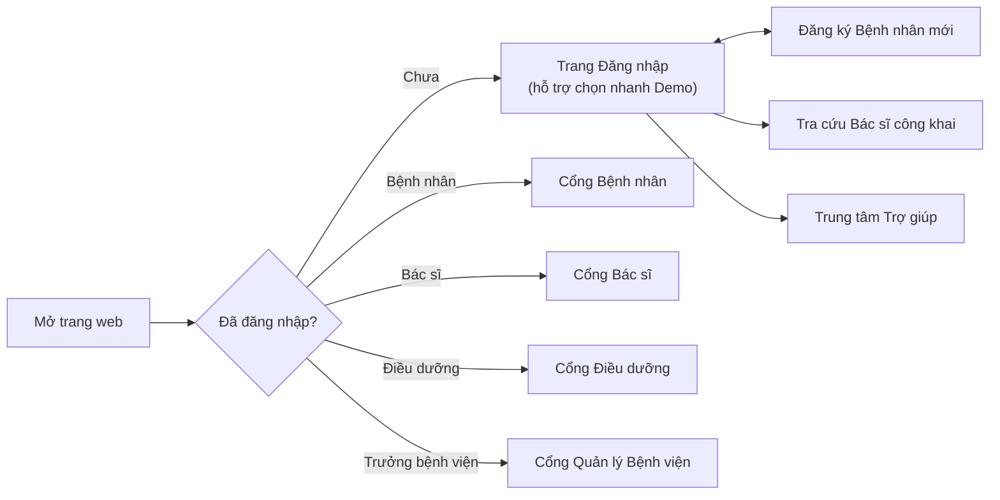

### 4.3.2. Bản đồ màn hình Cổng Bệnh nhân

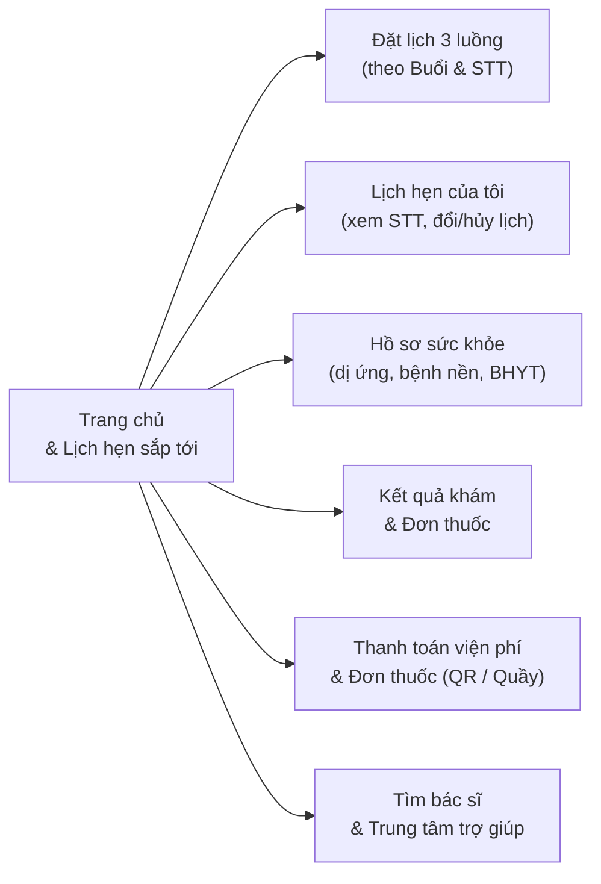

### 4.3.3. Bản đồ màn hình Cổng Bác sĩ

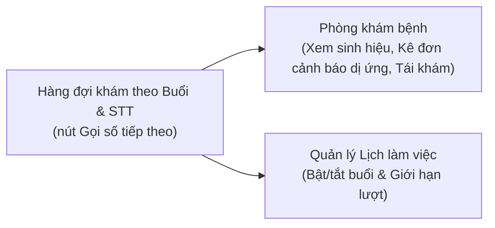

### 4.3.4. Bản đồ màn hình Cổng Điều dưỡng

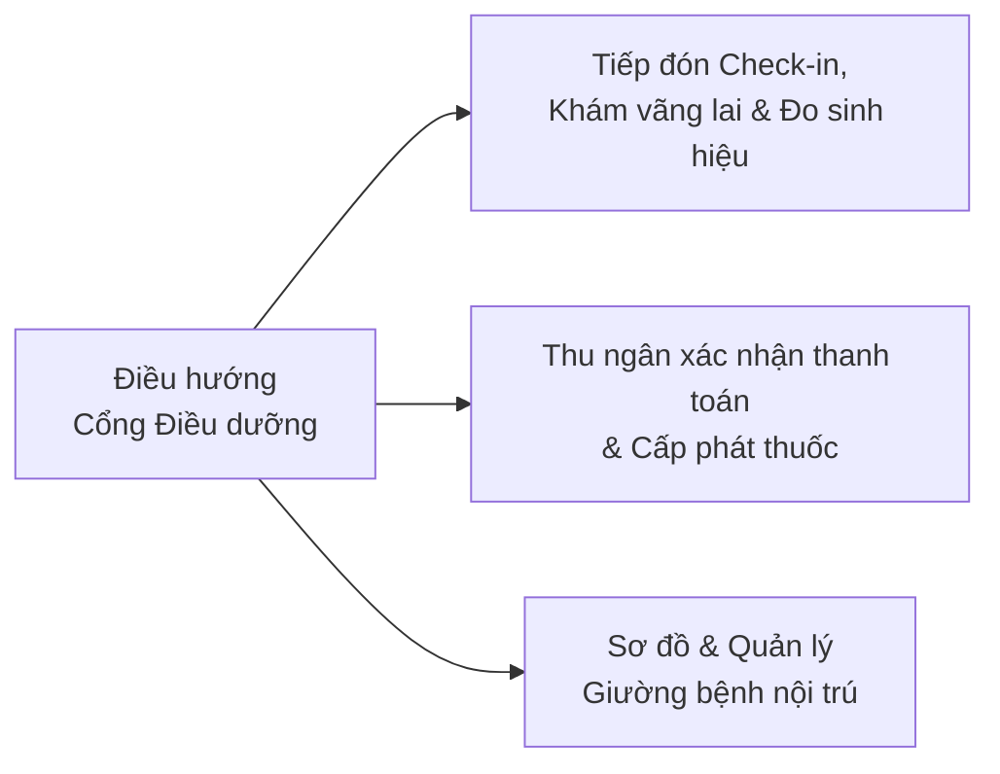

### 4.3.5. Bản đồ màn hình Cổng Trưởng bệnh viện

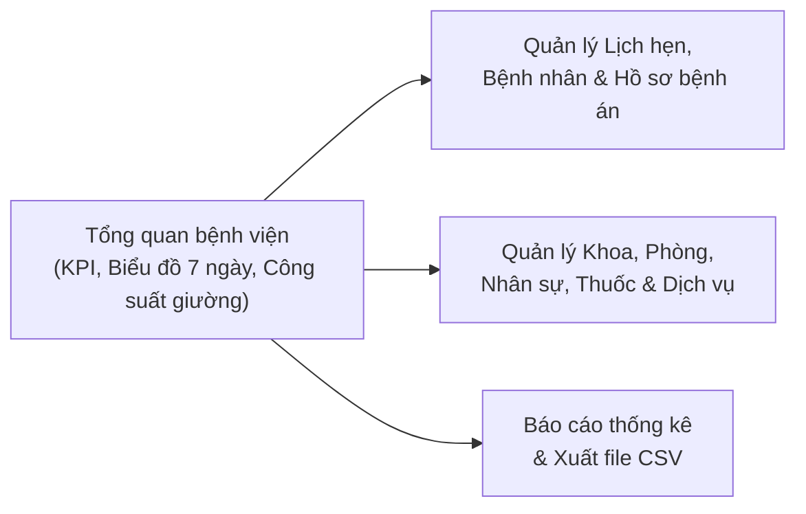

### Tóm tắt các màn hình chính theo từng vai trò

| Cổng vai trò | Các màn hình chính | Chức năng nổi bật trên giao diện |
| :--- | :--- | :--- |
| **Công khai & Đăng nhập** | Đăng nhập, Đăng ký, Tìm bác sĩ, Hỗ trợ | Cho phép chọn nhanh 1 chạm tài khoản mẫu của 4 vai trò; tra cứu đội ngũ bác sĩ không cần đăng nhập. |
| **Bệnh nhân** | Trang chủ, Đặt lịch khám, Lịch hẹn của tôi, Hồ sơ sức khỏe, Kết quả khám, Thanh toán | Đặt lịch 3 tab linh hoạt hiển thị số lượt trống & STT dự kiến; theo dõi STT đang khám tại phòng; tách riêng viện phí & tiền thuốc; tạo mã QR chuyển khoản. |
| **Bác sĩ** | Hàng đợi hôm nay, Phòng khám bệnh, Lịch làm việc | Gọi số thứ tự tiếp theo; xem sinh hiệu điều dưỡng đo & cảnh báo dị ứng đỏ khi kê đơn; đặt lịch tái khám cấp STT ngay trong màn hình khám. |
| **Điều dưỡng** | Tiếp đón & Sinh hiệu, Thu ngân & Phát thuốc, Quản lý Giường bệnh | Check-in theo mã/STT; tiếp nhận khách vãng lai; nhập sinh hiệu tự tính BMI; đối soát thanh toán QR/tiền mặt; sơ đồ giường trực quan theo từng khoa. |
| **Trưởng bệnh viện** | Tổng quan bệnh viện, Lịch hẹn, Bệnh nhân, Bác sĩ, Khoa & phòng, Hồ sơ bệnh án, Thuốc & DV, Báo cáo | 4 thẻ KPI, biểu đồ so sánh lượt khám 7 ngày, bác sĩ đang trực, bảng lịch hẹn hôm nay, biểu đồ công suất giường 78% theo khoa, biểu đồ doanh thu và xuất CSV. |

---

# Chương 5: Tổ chức Hệ thống & Triển khai

## 5.1. Tổ chức mã nguồn dự án

Dự án được chia tách gọn gàng thành hai phần độc lập nằm chung trong thư mục gốc `CNPM/`:
- **Thư mục gốc (`CNPM/`):** Chứa file cấu hình khởi chạy Docker (`docker-compose.yml`), file biến môi trường mẫu (`.env.example`), tài liệu hướng dẫn (`README.md`) và thư mục báo cáo (`docs/`).
- **Phần Máy chủ (`backend/`):**
  - `prisma/`: Chứa file định nghĩa 17 bảng dữ liệu (`schema.prisma`), file khởi tạo cấu trúc bảng kèm chỉ mục tối ưu (`migration.sql`) và chương trình nạp dữ liệu mẫu (`seed.ts`).
  - `src/`: Phân chia thành các nhóm xử lý rõ ràng gồm kiểm tra xác thực/phân quyền (`middleware/`), nhóm tiếp nhận yêu cầu theo từng vai trò (`routes/` cho Bệnh nhân, Bác sĩ, Điều dưỡng, Quản lý, Công khai, Thông báo), nhóm xử lý nghiệp vụ cốt lõi (`services/` cho Đặt lịch STT, Bệnh án & Dị ứng, Thanh toán & Phát thuốc, Giường bệnh, Thống kê) và bộ kiểm thử tự động (`tests/`).
- **Phần Giao diện (`frontend/`):**
  - `src/components/`: Chứa bộ thành phần giao diện dùng chung (`ui/`), khung bố cục thích ứng Mobile/Desktop (`layout/`) và các biểu đồ thống kê (`charts/`).
  - `src/pages/`: Chia thành các thư mục trang màn hình riêng cho từng vai trò (`auth/`, `public/`, `patient/`, `doctor/`, `nurse/`, `admin/`).

## 5.2. Tổng hợp các nhóm chức năng xử lý phía máy chủ

| Nhóm xử lý | Phạm vi quyền truy cập | Các nghiệp vụ đảm nhiệm |
| :--- | :--- | :--- |
| **Xác thực & Danh mục chung** | Công khai / Người đã đăng nhập | Đăng nhập, đăng ký bệnh nhân, xem lịch trống 3 luồng theo buổi, tra cứu bác sĩ/khoa/dịch vụ, nhận và đánh dấu đã đọc thông báo. |
| **Nghiệp vụ Bệnh nhân** | Chỉ Bệnh nhân | Đặt lịch cấp STT, xem danh sách & STT đang khám, đổi lịch/hủy lịch, cập nhật hồ sơ dị ứng & bệnh nền, xem bệnh án & đơn thuốc, xem hóa đơn và khởi tạo thanh toán QR/tiền mặt. |
| **Nghiệp vụ Bác sĩ** | Chỉ Bác sĩ | Xem hàng đợi theo buổi/STT, gọi số tiếp theo, xem hồ sơ & sinh hiệu bệnh nhân, kiểm tra cảnh báo dị ứng, lưu/công bố bệnh án + đơn thuốc + hóa đơn, đặt lịch tái khám, quản lý lịch trực. |
| **Nghiệp vụ Điều dưỡng** | Chỉ Điều dưỡng | Check-in bệnh nhân đặt trước, tạo phiếu vãng lai cấp STT, nhập sinh hiệu & thủ tục BHYT, đối soát xác nhận/từ chối thanh toán, cấp phát thuốc trừ tồn kho, xếp/chuyển/xuất giường bệnh. |
| **Nghiệp vụ Quản lý** | Chỉ Trưởng bệnh viện | Tổng hợp Dashboard KPI & biểu đồ, quản lý Khoa/Phòng/Giường/Nhân sự/Lịch trực/Thuốc/Dịch vụ, tra cứu hồ sơ toàn viện và xuất file báo cáo CSV. |

## 5.3. Dữ liệu mẫu khởi tạo phục vụ chạy thử & trình diễn

Khi khởi chạy lần đầu, hệ thống tự động nạp sẵn một kịch bản bệnh viện hoàn chỉnh:
- **07 Chuyên khoa:** Nội tổng quát, Ngoại khoa, Sản & Nhi, Tim mạch, Nhi khoa, Da liễu và Các khoa khác.
- **Đội ngũ bác sĩ & điều dưỡng:** Gồm các bác sĩ gắn liền với phòng khám (như BS. Hoàng Minh Long – Phòng 201 Nội tổng quát, BS. Trần Thảo Nguyên – Phòng 305 Tim mạch, BS. Nguyễn Quốc Huy – Phòng 102 Nhi khoa) và điều dưỡng trực tiếp nhận.
- **200 Giường bệnh nội trú:** Phân bổ trên các khoa với tỷ lệ sử dụng thực tế **156/200 giường (78%)**, còn 39 giường trống và 5 giường đang bảo trì.
- **Dữ liệu bệnh nhân & lịch sử 14 ngày:** Có sẵn tài khoản mẫu cho cả 4 vai trò (mật khẩu chung `123456`), lịch sử khám trong 14 ngày để vẽ biểu đồ so sánh 7 ngày, bệnh nhân có tiền sử dị ứng Penicillin để kiểm chứng cảnh báo kê đơn, hóa đơn đã thanh toán và hóa đơn chờ đối soát QR.

## 5.4. Hướng dẫn cài đặt & Chạy hệ thống

Cách đơn giản nhất để chạy toàn bộ hệ thống trên mọi máy tính:
1. Cài đặt và mở **Docker Desktop**.
2. Sao chép file `.env.example` thành `.env` ở thư mục gốc dự án.
3. Chạy lệnh khởi động Docker Compose tại thư mục gốc (`docker compose up --build`): Docker sẽ tự động khởi tạo cơ sở dữ liệu PostgreSQL 16, tạo 17 bảng, nạp dữ liệu mẫu và mở cả máy chủ xử lý lẫn giao diện web.
4. Truy cập trang web trên trình duyệt tại địa chỉ `http://localhost:5173` và dùng chức năng chọn nhanh tài khoản mẫu trên màn hình đăng nhập để trải nghiệm đầy đủ cả 4 vai trò.
5. Nếu muốn chia sẻ cho thành viên trong nhóm truy cập từ xa vào máy mình để dùng thử (kể cả trên điện thoại), chỉ cần bật **Tailscale** giữa các máy trong nhóm.

---

# Chương 6: Kiểm thử & Kết luận

## 6.1. Chiến lược kiểm thử

Hệ thống được kiểm tra chất lượng theo 3 lớp:
1. **Kiểm tra hợp lệ cấu trúc & kiểu dữ liệu:** Bảo đảm mô hình cơ sở dữ liệu, mã nguồn giao diện và máy chủ không có lỗi cú pháp hay sai lệch kiểu dữ liệu trước khi đóng gói.
2. **Kiểm thử logic nghiệp vụ cốt lõi:** Kiểm tra các tình huống quan trọng như đặt lịch không trùng STT, giữ nguyên STT khi hủy lịch, tính giờ dự kiến, phát hiện dị ứng thuốc, xác nhận thanh toán trọn gói và điều phối giường bệnh.
3. **Kiểm thử phân quyền & Vận hành thực tế trên Docker:** Kiểm tra việc chặn truy cập trái vai trò và chạy thử nghiệm trực tiếp với cơ sở dữ liệu PostgreSQL 16 thật trong Docker Compose.

## 6.2. Bảng kịch bản kiểm thử (Test Cases)

### 6.2.1. Kịch bản kiểm thử nghiệp vụ 4 vai trò

| Mã TC | Đối tượng | Tên kịch bản | Các bước thực hiện | Kết quả mong đợi |
| :--- | :--- | :--- | :--- | :--- |
| `TC-01` | Bệnh nhân | Đặt lịch 3 luồng & nhận STT | Chọn luồng đặt lịch (Khoa/Bác sĩ/Ngày) $\rightarrow$ Chọn Buổi Sáng $\rightarrow$ Nhập lý do khám và xác nhận. | Tạo lịch thành công, cấp STT tăng dần, hiển thị giờ dự kiến và gửi thông báo xác nhận. |
| `TC-02` | Bệnh nhân | Hủy lịch vẫn giữ nguyên STT người khác | Đang có STT `#1, #2, #3`; người `#2` bấm hủy lịch $\rightarrow$ người mới đặt thêm vào buổi đó. | Người `#2` chuyển sang Đã hủy; người `#3` vẫn giữ nguyên STT `#03`; người mới nhận STT `#04`. |
| `TC-03` | Bệnh nhân | Thanh toán chuyển khoản QR | Mở hóa đơn chưa thanh toán $\rightarrow$ Chọn hình thức chuyển khoản QR và xác nhận đã chuyển. | Hóa đơn chuyển sang trạng thái *Chờ đối soát* để điều dưỡng kiểm tra xác nhận. |
| `TC-04` | Bác sĩ | Gọi số tiếp theo | Trong buổi khám đang có bệnh nhân khám dở hoặc chờ $\rightarrow$ Bấm nút **Gọi số tiếp theo**. | Nhắc hoàn tất ca cũ (nếu đang khám), chuyển bệnh nhân kế tiếp vào trạng thái *Đang khám* và gửi thông báo gọi số. |
| `TC-05` | Bác sĩ | Cảnh báo dị ứng khi kê đơn | Mở bệnh nhân có tiền sử dị ứng `Penicillin` và bệnh nền `Loét dạ dày` $\rightarrow$ Thử kê `Amoxicillin` và `Ibuprofen`. | Hệ thống hiển thị cảnh báo mức độ nặng cho `Amoxicillin` (dị ứng Penicillin) và mức độ trung bình cho `Ibuprofen` (loét dạ dày). |
| `TC-06` | Bác sĩ | Công bố bệnh án & Tự tạo hóa đơn | Nhập chẩn đoán, chỉ định xét nghiệm, đơn thuốc và bấm **Công bố kết quả**. | Bệnh án được công bố, tự động tạo hóa đơn viện phí và hóa đơn thuốc tách biệt, hoàn tất lượt khám và báo cho bệnh nhân. |
| `TC-07` | Điều dưỡng | Tiếp đón Walk-in & Đo sinh hiệu | Đăng ký cho bệnh nhân đến trực tiếp (có đánh dấu ưu tiên) $\rightarrow$ Nhập huyết áp, mạch, nhiệt độ, chiều cao, cân nặng. | Cấp STT kế tiếp trong buổi, tự động tính chỉ số BMI và đưa bệnh nhân lên danh sách sẵn sàng khám của bác sĩ. |
| `TC-08` | Điều dưỡng | Xác nhận thanh toán & Phát thuốc | Vào mục Thu ngân bấm xác nhận thu tiền hóa đơn thuốc $\rightarrow$ Chuyển sang cấp phát thuốc. | Hóa đơn chuyển *Đã thanh toán*, mở khóa đơn thuốc và khi bấm cấp phát sẽ tự trừ tồn kho. Chặn cấp phát nếu hóa đơn chưa thanh toán. |
| `TC-09` | Điều dưỡng | Điều phối giường bệnh | Chọn giường trống để xếp nhập viện $\rightarrow$ Chuyển sang giường khác $\rightarrow$ Làm thủ tục xuất viện. | Trạng thái giường và lịch sử thay đổi chính xác; không cho phép xếp thêm bệnh nhân vào giường đang có người nằm. |
| `TC-10` | Trưởng BV | Xem Dashboard & Xuất báo cáo | Mở trang Tổng quan bệnh viện và bấm xuất file báo cáo CSV. | Hiển thị đủ 4 KPI, biểu đồ 7 ngày, bác sĩ đang trực, công suất giường theo khoa (78%) và tải xuống được file CSV mở chuẩn tiếng Việt trên Excel. |

### 6.2.2. Kịch bản kiểm thử an toàn dữ liệu & Phân quyền

| Mã TC | Nhóm kiểm tra | Kịch bản kiểm thử | Kết quả mong đợi |
| :--- | :--- | :--- | :--- |
| `TC-11` | Chống trùng STT khi đặt cùng lúc | Hai yêu cầu cùng đặt lịch cho một bác sĩ vào một buổi tại cùng một thời điểm. | Cơ chế khóa tuần tự bảo đảm cấp 2 STT liên tiếp khác nhau, tuyệt đối không trùng số. |
| `TC-12` | Chống đặt trùng buổi | Một bệnh nhân cố tình đặt 2 lịch còn hiệu lực với cùng một bác sĩ trong cùng buổi. | Hệ thống từ chối lượt đặt thứ 2 và thông báo bệnh nhân đã có lịch trong buổi này. |
| `TC-13` | Phân quyền truy cập | Chưa đăng nhập truy cập các trang nội bộ, hoặc dùng tài khoản Bệnh nhân thử vào trang của Bác sĩ / Điều dưỡng / Quản lý. | Hệ thống chặn truy cập trái phép và tự động điều hướng về đúng cổng vai trò hợp lệ. |

## 6.3. Kết quả kiểm tra và chạy thử thực tế

Hệ thống (**17 bảng PostgreSQL + 12 cột JSONB**, Backend, Frontend và Docker Compose) đã được kiểm thử và chạy thực tế thành công:

| Hạng mục kiểm tra | Phạm vi thực hiện | Kết quả đạt được |
| :--- | :--- | :--- |
| **Kiểm tra cấu trúc CSDL** | Kiểm tra thiết kế Prisma & 17 bảng PostgreSQL | Hợp lệ hoàn toàn; khởi tạo sạch trên PostgreSQL 16 cùng dữ liệu mẫu (200 giường, 7 bác sĩ, 2 điều dưỡng, 21 lịch hẹn mẫu). |
| **Bộ kiểm thử tự động Backend** | 4 nhóm kiểm thử nghiệp vụ (Đặt lịch STT, Dị ứng & Bệnh án, Thanh toán & Giường, Phân quyền) | **Đạt 20/20 tình huống kiểm thử** *(chạy bằng dữ liệu giả lập trong môi trường test tự động)*. |
| **Đóng gói Backend & Frontend** | Biên dịch TypeScript và đóng gói bản phát hành | Cả Backend và Frontend đều biên dịch thành công, không còn lỗi kiểu hay lỗi giao diện. |
| **Chạy thực tế trên Docker Compose** | Khởi chạy đồng thời 3 dịch vụ (PostgreSQL, Backend, Frontend) | Trang web hoạt động mượt mà trên trình duyệt; các màn hình Bệnh nhân, Bác sĩ, Điều dưỡng và Dashboard Quản lý hiển thị đúng số liệu từ JSONB (công suất giường 78%, sinh hiệu, đơn thuốc, hóa đơn). |

## 6.4. Đánh giá và Hướng phát triển

### 6.4.1. Kết quả đạt được
- Hoàn thành trọn vẹn mô hình bệnh viện điện tử 4 vai trò sát với quy trình thực tế tại Việt Nam (đặt lịch 3 luồng theo Buổi Sáng/Chiều và cấp STT tự động).
- Tối ưu hóa cơ sở dữ liệu trên một hệ quản trị **PostgreSQL 16 + JSONB** duy nhất, cân bằng tốt giữa tính an toàn tài chính/y tế và tính linh hoạt dữ liệu.
- Giao diện đồng bộ, rõ nét, hỗ trợ cả máy tính và điện thoại.

### 6.4.2. Hạn chế và Hướng phát triển tiếp theo
1. **Cập nhật STT trực tiếp (Realtime):** Hiện tại trang theo dõi của bệnh nhân và thông báo đang đồng bộ định kỳ; trong phiên bản tới có thể nâng cấp truyền tải tức thời qua WebSocket để màn hình phòng chờ nhảy số ngay lập tức khi bác sĩ gọi bệnh nhân.
2. **Thanh toán trực tuyến thực tế:** Tích hợp cổng thanh toán ngân hàng/VietQR thật có xác nhận giao dịch tự động thay cho bước đối soát thủ công mô phỏng.
3. **Liên thông Bảo hiểm Y tế & Tối ưu tải trang:** Kết nối tra cứu thẻ BHYT trực tuyến và tách nhỏ mã giao diện theo từng vai trò để tăng tốc độ tải trang trên mạng di động.
